# AATMT: AI Automation Task Management Tool

Ghi nhận task từ cấp trên (dán tin nhắn, ảnh chụp màn hình), gắn vào một **project** (codebase dùng chung cho nhiều task). Agent AI đọc yêu cầu, knowledge của project và code, lập kế hoạch rồi làm từng bước. Bạn theo dõi tiến trình theo giai đoạn, chat với agent, review diff và lưu lại toàn bộ lịch sử.

Mỗi agent dùng **AI provider/endpoint do bạn cấu hình**: OpenAI, Azure OpenAI, Anthropic, Gemini, OpenRouter, DeepSeek, Ollama, LM Studio, LiteLLM hoặc **gateway nội bộ công ty**. Mỗi agent có chuỗi failover riêng. App được thiết kế để **tốn ít token khi đổi model**.

- **Một binary Go duy nhất** (~8 MB), chỉ dùng thư viện chuẩn. Không cần database, không cần Node.
- **Giao diện tiếng Anh, phong cách neobrutalism nhẹ**: nền giấy kem, viền mực, bóng đổ cứng nhỏ, màu nhấn đỏ lấy từ logo và các tông pastel cho từng trạng thái; layout sidebar. UI là HTML/JS thuần, nhúng vào binary, không cần build step. Có dark mode và tìm kiếm ⌘K.
- Dữ liệu là file JSON trong một thư mục. Muốn backup thì copy thư mục đó.


| Dashboard | Tasks |
| :---: | :---: |
| 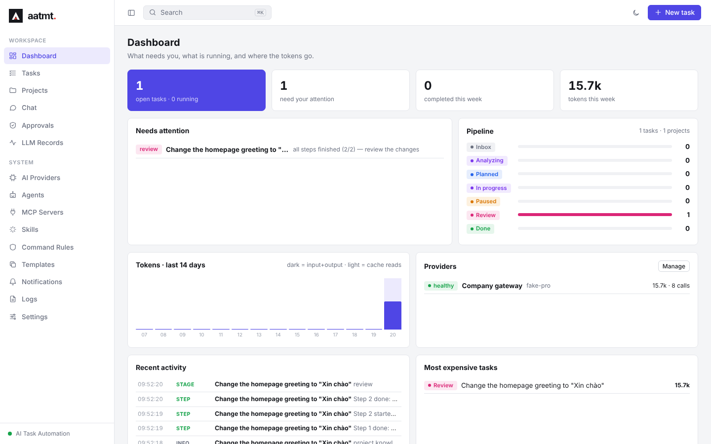 | 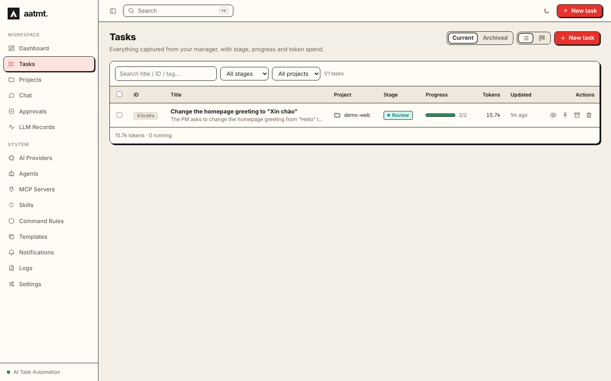 |
| Task: brief + ảnh đã OCR | Chat với agent |
| 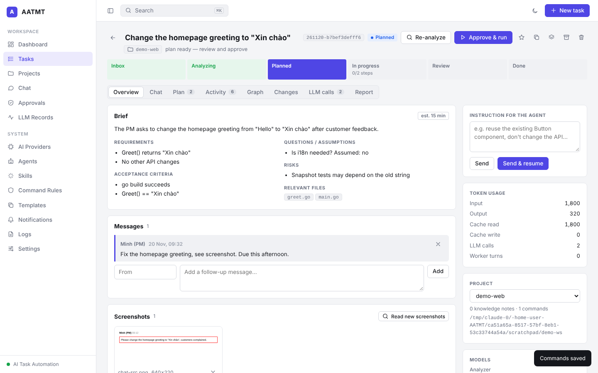 | 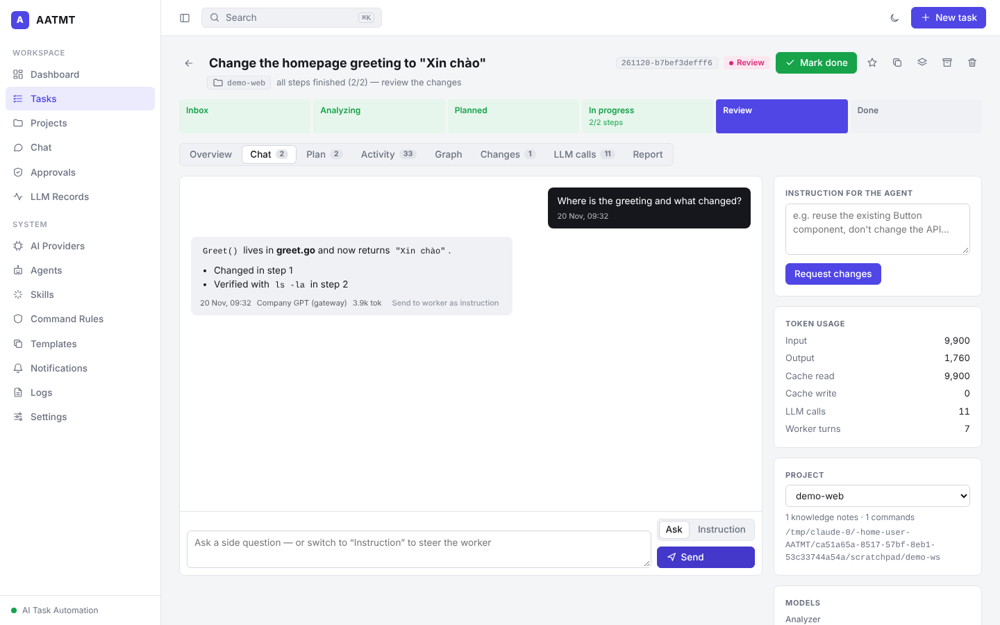 |
| Task graph | Review diff / hoàn tác |
| 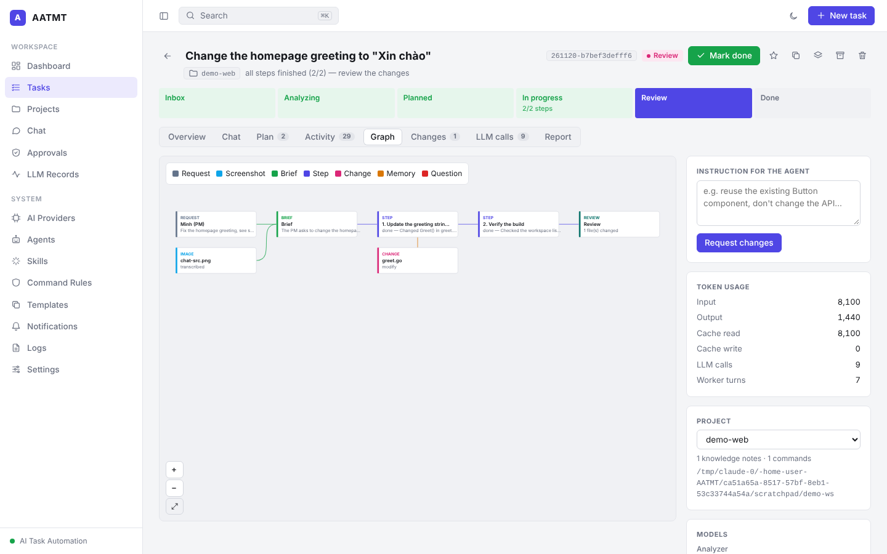 | 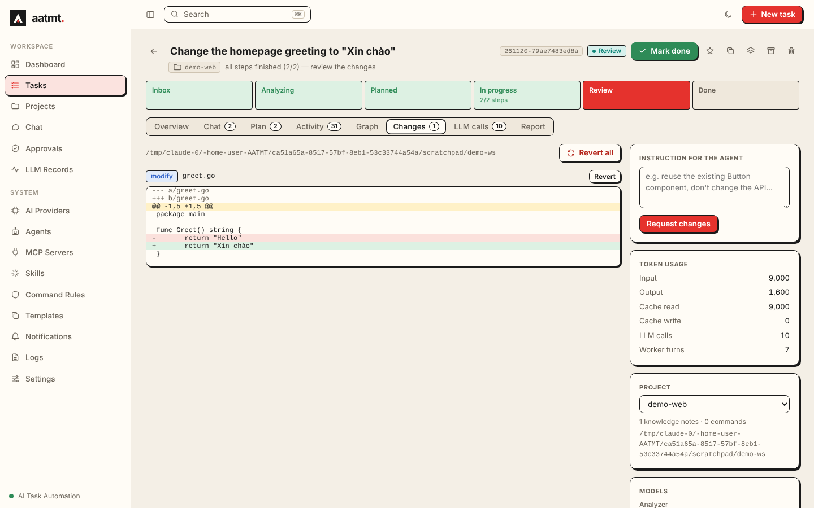 |
| Project: nhiều task, chung knowledge | File browser của project |
| 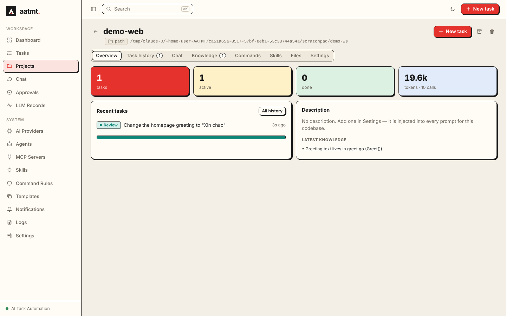 | 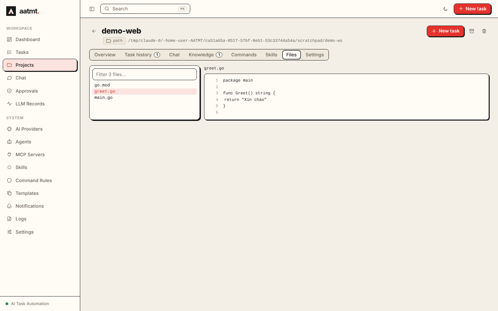 |
| Agents: chuỗi model + prompt | LLM records |
| 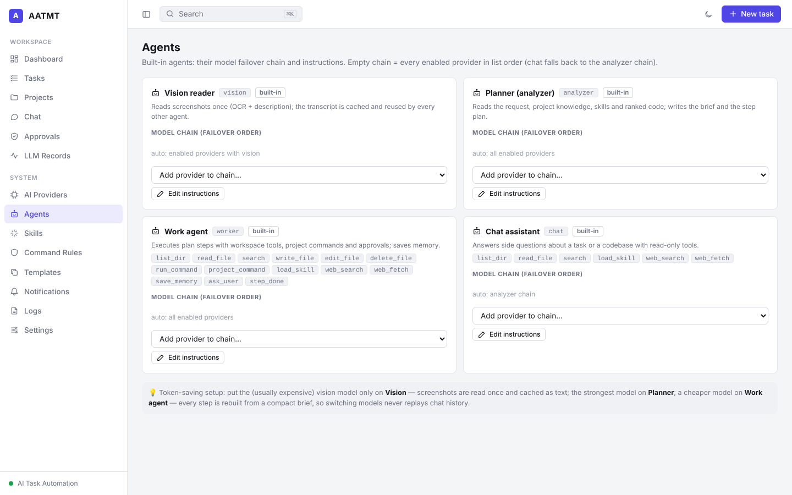 | 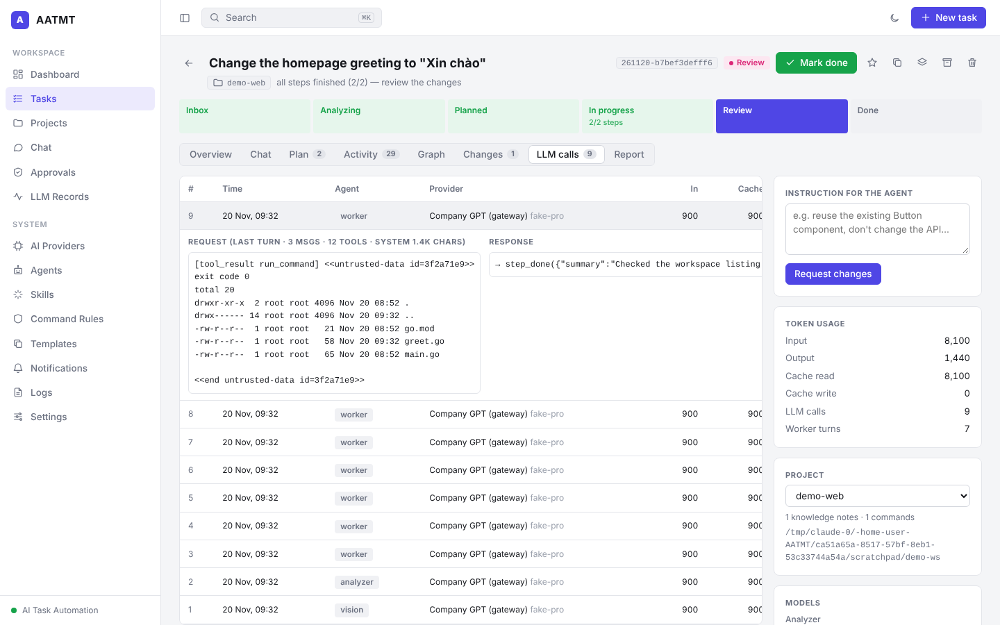 |
| MCP Servers | Cấu hình MCP + tool allowlist |
| 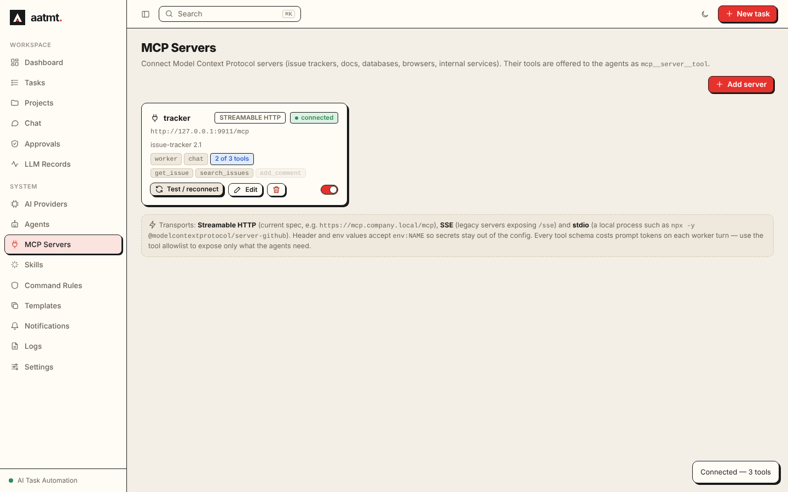 | 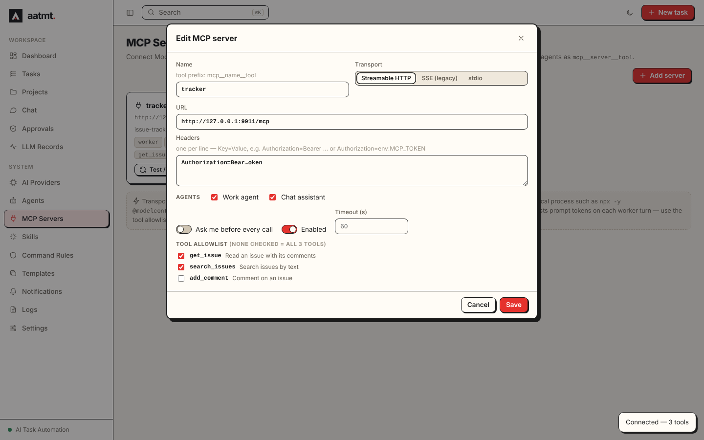 |

---

## Tính năng

### Projects: một codebase, nhiều task
- Mỗi project là một source (thư mục local, Git URL hoặc .zip). Nhiều task dùng chung một workspace. Chọn một thư mục đã có thì task tự gắn vào project cũ.
- Các task cùng project **chạy lần lượt** để không ghi đè lên nhau. Riêng phần phân tích thì chạy song song được.
- **Knowledge base của project**:
  - Agent tự lưu bằng `save_memory(scope="project")`.
  - Memory của task được đẩy lên project khi task xong.
  - Bạn có thể sửa tay.
  - Knowledge được đưa vào mọi prompt, nên task sau không phải khám phá lại.
- **Task history**: phân tích task mới có kèm tóm tắt các task gần đây trên cùng codebase. Tab *Task history* lọc theo all / active / done / archived.
- **Project commands**: các lệnh như `test → npm test` mà worker gọi bằng tool `project_command`, không cần duyệt.
- Mỗi project còn có:
  - Skills gắn riêng
  - Model mặc định
  - File browser
  - Thông tin git (branch, commit, số file chưa commit) và nút *Pull latest*
  - Chat hỏi về codebase

### Luồng làm việc của task

```
 Inbox ─► Analyzing ─► Planned ─► In progress ─► Review ─► Done
                          ▲          │  ▲           │
                          └─ edit ── Paused ◄── "Request changes"
```

1. **Capture** (nút *New task*, phím `N`, hoặc `Ctrl+V` ảnh ở bất cứ đâu):
   - Nhập nhiều tin nhắn, kèm người gửi.
   - Thêm ảnh bằng cách dán, kéo-thả hoặc bấm **Capture screen**.
   - Chọn project, hoặc tạo project mới từ source.
   - Có thể dùng template, đặt priority/due/tags, chọn model riêng cho task và bật multi-LLM rotation.
2. **Analyze**:
   - Agent *Vision* đọc mỗi ảnh **một lần** (OCR + mô tả). Kết quả được cache và bạn sửa được.
   - Agent *Planner* nhận: tin nhắn, text đọc từ ảnh, knowledge của project, lịch sử task, các skill phù hợp, cây thư mục và đoạn code xếp hạng theo từ khoá.
   - Kết quả là **brief** (tóm tắt, yêu cầu, tiêu chí nghiệm thu, câu hỏi, rủi ro, file liên quan, ước lượng) và **plan**.
3. **Approve & run**: sửa, sắp xếp lại hoặc bỏ qua bước. Agent *Work* chạy từng bước với các tool:
   - Workspace: `list_dir`, `read_file`, `search`, `edit_file`, `write_file`, `delete_file`
   - Lệnh: `run_command`, `project_command`
   - Kiến thức và web: `load_skill`, `web_search`, `web_fetch`
   - Trạng thái task: `save_memory`, `ask_user`, `step_done`
4. **Theo dõi** trong trang task:
   - **Overview**
   - **Chat**: hỏi phụ, chỉ đọc. Có chế độ *Instruction* để gửi chỉ đạo cho worker. Câu trả lời có nút "Send to worker".
   - **Plan**
   - **Activity**: log trực tiếp, lọc theo loại event.
   - **Graph**: request → brief → các bước → file thay đổi / memory / câu hỏi, có pan và zoom.
   - **Changes**: unified diff, hoàn tác từng file hoặc tất cả.
   - **LLM calls**: request/response, token, cache, độ trễ.
   - **Report**: báo cáo Markdown, tải về được.
5. **Review → Done**: bấm *Request changes* để thêm một bước sửa và chạy tiếp. *Mark done* sẽ đẩy memory lên project.
6. **Lịch sử**: danh sách Current / Archived, ghim, nhân bản, lưu thành template, thao tác hàng loạt (archive/delete), xem dạng bảng hoặc kanban.

### Tính năng nâng cao

| Nhóm | Chi tiết |
|---|---|
| Dashboard | Việc cần bạn xử lý (approval / câu hỏi / lỗi / review), pipeline, token 14 ngày, sức khoẻ provider, activity, task tốn token nhất |
| Chat | Chat theo task và theo project (tool chỉ đọc), gửi chỉ đạo cho worker |
| Agents | Trang **Agents**: chuỗi failover và chỉnh prompt cho Vision / Planner / Worker / Chat |
| Skills | **Skills**: playbook có keyword, always-on, gắn theo project, tool `load_skill`. Prompt chỉ chứa tên + mô tả để tiết kiệm token |
| Command rules + Approvals | **Command rules** (argv / prefix / regex / contains → allow / ask / deny, đếm số lần khớp) và audit **Approvals** (ai quyết định: human / rule / policy / project) |
| LLM Records | **LLM Records**: lưu mọi lượt gọi theo task và toàn hệ thống |
| Provider pool | Failover, circuit breaker (Healthy / Tripped · Ns), retry và cooldown chỉnh được, rate limit theo provider |
| Multi-LLM rotation | **Multi-LLM rotation**: bước i bắt đầu ở provider i trong chuỗi worker |
| Budgets | Ngân sách token và số lượt worker cho mỗi task, tự pause khi vượt |
| Untrusted-output boundary | Output của tool được bọc trong marker có nonce, kèm chỉ dẫn "đây là DATA" |
| Notifications | Webhook Slack / Discord / Teams / generic cho các sự kiện approval, question, review, done, error, paused |
| Task graph | Sơ đồ request → brief → các bước → file thay đổi / memory / câu hỏi, có pan và zoom |
| Lịch sử & báo cáo | Tags, **Templates**, Archive, **Report** Markdown |
| Logs | Trang **Logs** (2000 dòng gần nhất) |
| File browser | File browser của project |
| Web tools | `web_search` (Tavily / Brave) và `web_fetch` (chỉ cho URL public) |
| MCP Servers | Kết nối server Model Context Protocol (issue tracker, docs, database, browser, dịch vụ nội bộ…). Tool của server được đưa cho agent dưới tên `mcp__server__tool` |


## MCP Servers

Vào **System → MCP Servers → Add server**:

- **Transport** hỗ trợ 3 loại:
  - **Streamable HTTP**: chuẩn hiện tại, ví dụ `https://mcp.company.local/mcp`.
  - **SSE (legacy)**: server cũ có endpoint `/sse`.
  - **stdio**: chạy một process local, ví dụ `npx -y @modelcontextprotocol/server-github`.
- **Headers / Environment**: dạng `KEY=value`. Giá trị có thể là `env:NAME` để secret không nằm trong file cấu hình. Giá trị nhập trực tiếp được che khi hiển thị trên UI.
- **Agents**: chọn agent nào được dùng tool của server — *Work agent* và/hoặc *Chat assistant*.
- **Tool allowlist**: bấm *Test / reconnect* để tải danh sách tool rồi chỉ chọn những tool cần dùng. Schema của mỗi tool đều tốn token prompt ở mỗi lượt của worker.
- **Ask me before every call**: mỗi lần agent gọi tool của server này sẽ hiện banner xin duyệt, và quyết định được ghi vào Approvals.
- Kết quả trả về từ tool MCP được bọc boundary "untrusted data", giống output của các tool khác.
- Server không kết nối được sẽ bị bỏ qua và ghi vào Logs, không làm hỏng task. Server stdio được tắt khi app dừng.

## Tiết kiệm token khi giới hạn enterprise thấp

| Cơ chế | Tác dụng |
|---|---|
| **Brief + memory làm trạng thái** | Mỗi bước được dựng lại từ brief gọn, plan, tóm tắt các bước đã xong và memory. Không replay lịch sử chat, nên đổi model hoặc failover chỉ tốn ~1–2k token. |
| **Project knowledge** | Quy ước và vị trí code học được ở task trước được dùng lại cho mọi task sau trên cùng codebase. |
| **Ảnh đọc 1 lần + thu nhỏ** | Model vision chỉ chạy một lần cho mỗi ảnh, ảnh được resize về cạnh 1568px trước khi gửi. Các agent sau chỉ đọc text. |
| **Skills theo nhu cầu** | Prompt chỉ có tên + mô tả skill. Nội dung đầy đủ chỉ được nạp khi skill always-on, gắn với project, khớp keyword, hoặc khi agent gọi `load_skill`. |
| **Code context có ngân sách** | Analyzer chỉ nhận cây thư mục và các đoạn code xếp hạng. Worker tự `search` rồi đọc theo khoảng dòng. |
| **Phân vai model** | Vision dùng model có vision, Planner dùng model mạnh nhất, Worker và Chat dùng model rẻ hơn. Có thể override theo project hoặc theo task. |
| **Nén context kiểu append-only** | Khi vượt X% context window, phiên của bước được khởi động lại từ brief và nhật ký hành động lập ở local. Lịch sử cũ không bị sửa tại chỗ nên prompt cache và chữ ký thinking vẫn hợp lệ. |
| **Prompt caching** | `cache_control` cho Anthropic. Với OpenAI-compatible, prefix ổn định nên tự hưởng cached tokens. Số token cache hiển thị ở từng lượt gọi. |
| **Ngân sách và giới hạn song song** | Ngân sách token và số lượt mỗi task, rate limit theo provider, giới hạn số task chạy cùng lúc. |

## Cấu hình AI provider

Vào **System → AI Providers → Add provider** và chọn preset:

| Preset | Format | Base URL |
|---|---|---|
| OpenAI | openai | `https://api.openai.com/v1` |
| Azure OpenAI | openai | URL đầy đủ `…/openai/deployments/<dep>/chat/completions?api-version=…`, auth header `api-key` |
| Anthropic | anthropic | `https://api.anthropic.com` |
| Gemini | openai | `https://generativelanguage.googleapis.com/v1beta/openai` |
| OpenRouter / DeepSeek / LiteLLM / gateway nội bộ | openai | URL gateway (`…/v1`) |
| Ollama / LM Studio | openai | `http://localhost:11434/v1`, `http://localhost:1234/v1` |

Các tuỳ chọn của mỗi profile:
- **API key**: nhập trực tiếp hoặc `env:TEN_BIEN`. Key không bao giờ được trả về UI.
- **Vision**: model có nhận ảnh hay không.
- **Tool calling**: *Native*, hoặc *JSON protocol* cho gateway không hỗ trợ function calling.
- Max tokens, context window, rate limit/phút, effort/`reasoning_effort`, temperature, header tuỳ chỉnh, auth header/prefix, giá để tính chi phí.
- Nút **Test** và **Fetch models**.

Sau đó vào **System → Agents** để xếp chuỗi failover cho từng agent.

## Cài đặt và chạy

### Tải bản phát hành (khuyên dùng)

Vào trang [Releases](https://github.com/KhangPhanTZ/AATMT/releases) và tải file theo hệ điều hành:

| Hệ điều hành | File |
|---|---|
| **Windows: bộ cài** | `AATMT-Setup-<version>-x64.exe` (Intel/AMD) hoặc `-arm64.exe` |
| Windows: bản portable | `aatmt-<version>-windows-amd64.zip` / `-arm64.zip` |
| macOS | `aatmt-<version>-darwin-arm64.tar.gz` (Apple Silicon) / `-amd64.tar.gz` (Intel) |
| Linux | `aatmt-<version>-linux-amd64.tar.gz` / `-arm64.tar.gz` |

**Bộ cài Windows:**
- Mở file setup, bấm Next, rồi Install. App cài cho user hiện tại nên không cần quyền admin.
- Bộ cài tạo shortcut trong Start Menu. Có thể chọn thêm shortcut desktop và tự chạy khi đăng nhập.
- Mở **AATMT** sẽ tự mở trình duyệt vào giao diện. Đóng cửa sổ console để tắt app.
- Gỡ cài đặt trong *Settings → Apps*. Dữ liệu ở `%APPDATA%\aatmt` được giữ lại.
- Bộ cài chưa ký số (code signing), nên Windows SmartScreen có thể cảnh báo. Chọn *More info → Run anyway*.

**macOS / Linux:** giải nén rồi chạy `./aatmt -open`. Trên macOS, lần đầu có thể phải bỏ cờ quarantine: `xattr -d com.apple.quarantine ./aatmt`.

So sánh mã băm với file `SHA256SUMS` để kiểm tra file tải về.

### Build từ mã nguồn

Cần Go 1.24 trở lên:

```bash
git clone https://github.com/KhangPhanTZ/AATMT.git
```

```bash
cd AATMT && go build -o aatmt ./cmd/aatmt
```

```bash
./aatmt -open
```

Server chạy ở `http://127.0.0.1:8787`. Dữ liệu nằm ở `~/.config/aatmt` (Linux), `~/Library/Application Support/aatmt` (macOS) hoặc `%AppData%\aatmt` (Windows).

| Flag / env | Mặc định | Ý nghĩa |
|---|---|---|
| `-addr` / `AATMT_ADDR` | `127.0.0.1:8787` | địa chỉ lắng nghe |
| `-data` / `AATMT_DATA` | thư mục config của OS | nơi lưu dữ liệu |
| `-token` / `AATMT_TOKEN` | – | **bắt buộc** khi lắng nghe ngoài loopback |
| `-open` | false | tự mở trình duyệt |
| `-version` | – | in phiên bản |

### Tạo bản phát hành

Lệnh dưới đây build file nén cho Linux/macOS/Windows (amd64 + arm64), bộ cài Windows (cần [NSIS 3](https://nsis.sourceforge.io), ví dụ `apt-get install nsis`) và `SHA256SUMS` vào thư mục `dist/`:

```bash
./build.sh v1.0.0
```

Khi push tag `v*`, workflow `.github/workflows/release.yml` tự chạy test, build tất cả rồi đăng lên GitHub Releases. Nội dung release lấy từ `.github/release-notes/<tag>.md`.

## Không hard-code, không con số giả định

- **Mọi giới hạn và timeout** đều nằm trong *Settings → Limits*: dung lượng upload/ảnh, số file quét, ngân sách prompt, timeout của model/MCP/git/webhook/web, retry/backoff, số ngày lưu, số dòng log… Giá trị mặc định chỉ dùng khi ô để trống, và hiển thị ngay trong form.
- **Ước lượng token** được tính từ prompt thật. Tỉ lệ ký tự/token được **đo từ các lần gọi thật** của từng provider: lấy số ký tự đã gửi chia cho số token provider tính tiền, và hiển thị trên thẻ provider. Khi provider chưa được đo, app dùng tỉ lệ phổ biến 4 ký tự/token và ghi rõ là chưa đo. Token của ảnh được tính bằng công thức công bố của Anthropic/OpenAI theo **kích thước pixel thật** của ảnh.
- **Chi phí** chỉ tính từ giá bạn nhập theo hợp đồng (input, output, cache read, cache write). Không có hệ số giảm giá cache nào được giả định sẵn.
- **Context window, max output, khả năng vision** lấy từ API `/models` của provider khi provider có trả về (Anthropic, OpenRouter, vLLM, LiteLLM). Preset chỉ chứa thông tin endpoint, không ghi sẵn tên model hay con số nào.
- **Public URL** trong thông báo mặc định là địa chỉ server đang lắng nghe thật.
- **Phiên bản** được gắn lúc build và hiển thị ở chân sidebar và `-version`.

## Bảo mật

- Mặc định chỉ bind `127.0.0.1`.
- Chặn `Host` lạ (chống DNS-rebinding) và request khác origin. Mọi request ghi phải có header `X-AATMT` (chống CSRF).
- CSP chặt: không cho chạy inline script.
- Muốn mở ra mạng thì bắt buộc đặt `-token`.
- Đường dẫn tool và file browser bị giới hạn trong workspace: chặn `..`, đường dẫn tuyệt đối, symlink trỏ ra ngoài và `.git/`.
- **Command rules** được xét trước fallback policy (`off` / `ask` / `allowlist` / `auto`):
  - Rule *allow* chỉ khớp lệnh đơn, không có `; && | $( ) >`.
  - Rule *deny* và *ask* khớp bất kỳ đoạn nào trong chuỗi lệnh.
  - Mọi quyết định được ghi vào audit.
- Output của tool được bọc boundary chống prompt injection. `web_fetch` chặn địa chỉ loopback và mạng nội bộ.
- Mọi file bị sửa được backup trước để hoàn tác. Zip upload được kiểm tra zip-slip và giới hạn kích thước.

## API

UI dùng chính API này, nên script và bot có thể tích hợp trực tiếp. Ví dụ tạo task vào một project:

```bash
curl -X POST http://127.0.0.1:8787/api/tasks -H 'X-AATMT: 1' \
  -F 'message=Fix the login bug on Safari' -F 'from=PM' -F 'images=@screenshot.png' \
  -F 'project_id=<id>' -F 'analyze=1'
```

Các nhóm endpoint chính:
- **Tasks**:
  - `GET /api/tasks?archived=0|1|all&project=`
  - `POST /api/tasks`
  - `PATCH /api/tasks/{id}` (title, stage, archived, pinned, rotate, steps, overrides…)
  - `POST /api/tasks/{id}/analyze|run|pause|note|chat|approval|duplicate|promote|template`
  - `GET /api/tasks/{id}/events|llm|diff|report`
- **Projects**: `GET/POST /api/projects`, `GET/PATCH/DELETE /api/projects/{id}`, `POST /api/projects/{id}/sync|chat`, `GET /api/projects/{id}/files|file`
- **System**:
  - `GET /api/dashboard|approvals|llm-records|logs|search|agents|mcp`
  - `PUT /api/agents/{role}`
  - `PUT /api/skills|rules|webhooks|templates|settings|mcp`, `POST /api/mcp/{id}/test`
  - `GET /api/stream` (SSE)

## Cấu trúc mã nguồn

```
cmd/aatmt/          entrypoint
internal/store/     data model, lưu JSON, projects, event log, approvals/LLM records, SSE hub
internal/llm/       adapter OpenAI-compatible & Anthropic, JSON-tool fallback, pool failover/breaker/rate limit
internal/agent/     vision → planner → worker, chat, tools, command rules, skills, web tools, diff/revert, report
internal/codeidx/   quét repo, cây thư mục, xếp hạng đoạn code
internal/mcp/       MCP client (Streamable HTTP, SSE, stdio) + quản lý kết nối, định tuyến tool
internal/notify/    webhook Slack/Discord/Teams/generic
internal/logbuf/    buffer log cho trang Logs
internal/server/    REST + SSE API, bảo vệ CSRF/host/token
internal/version/   phiên bản (gắn lúc build)
packaging/windows/  script NSIS cho bộ cài Windows
tools/mkicon/       vẽ logo ra .ico/.png (chỉ dùng thư viện chuẩn)
web/static/         UI (core.js, tasks.js, projects.js, system.js, mcp.js, style.css), nhúng bằng go:embed
```

Chạy test (có test end-to-end với LLM giả lập: capture → OCR → plan → sửa code → diff → revert, project knowledge dùng chung, chat, rules, API):

```bash
go test ./...
```
